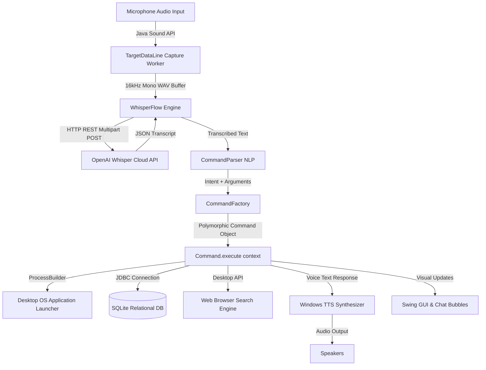

# JARVIS: A Java-Based Intelligent Voice Assistant
### KTU S3 CSE • Object-Oriented Programming Mini Project (CSL 203)

Speech-driven desktop assistant built on core Object-Oriented Programming principles, OpenAI WhisperFlow, and SQLite persistence.

---

## 👥 Engineering Team & Role Division

| Register No. | Student Name | Core Module Focus | Primary Classes Authored |
| :--- | :--- | :--- | :--- |
| **TLY25CS065** | **JOBIN** | Audio Capture & Java Sound API | `AudioRecorderService`, `AudioFormatHelper`, `AudioPlayerService` |
| **TLY25CS083** | **FARSIN** | OpenAI WhisperFlow & Networking | `WhisperFlowService`, `WhisperApiClient`, `MockSpeechRecognizer` |
| **TLY25CS104** | **SHARON** | OOP Command Architecture & OS Dispatch | `Command`, `AbstractCommand`, `CommandParser`, `CommandFactory` |
| **TLY25CS120** | **THEERTH** | SQLite Relational Database & Swing GUI | `DatabaseManager`, `ReminderDAO`, `JarvisMainFrame`, `ArcReactorVisualizer` |

---

## 🏛️ Core OOP Principles Applied

### 1. Encapsulation
- **Hardware Sound Streams & Network Buffers**: Low-level audio hardware lines (`TargetDataLine`), binary WAV byte arrays, and HTTP multipart stream states are encapsulated inside private fields in `AudioRecorderService` and `WhisperApiClient`.
- **System Configuration**: Sensitive OpenAI authorization tokens and user preferences are strictly protected within the `ConfigManager` Singleton through synchronized accessors.
- **Immutable Contexts**: `CommandContext` and `CommandResult` encapsulate command inputs, parsed parameters, and execution outcomes as immutable or read-only structures.

### 2. Inheritance
- **Command Base Class**: `AbstractCommand` provides shared lifecycle functionality:
  ```
  Command (interface)
     ▲
     │ (implements)
  AbstractCommand (abstract base class)
     ▲
     ├── AppLaunchCommand
     ├── ReminderCommand
     ├── SystemInfoCommand
     ├── WebSearchCommand
     ├── GeneralQueryCommand
     ├── MediaControlCommand
     ├── CustomShortcutCommand
     └── HelpCommand
  ```
- **Template Method Pattern**: `AbstractCommand.execute()` handles execution timing, error interception, and automatic relational audit logging to `tbl_interaction_logs` before delegating to `doExecute()`.

### 3. Polymorphism
- **Dynamic Runtime Dispatch**: The central engine (`JarvisEngine`) interacts exclusively with the generic `Command` interface.
- At runtime, `CommandFactory` dynamically instantiates the appropriate subclass based on natural language intent.
- When `command.execute(context)` is invoked, Java's dynamic method lookup triggers the appropriate subclass logic without the caller knowing the concrete class.
- **Pluggable Speech Recognizers**: `SpeechRecognizer` interface enables polymorphic swapping between cloud `WhisperApiClient` and `MockSpeechRecognizer`.

### 4. Abstraction
- Complex platform-dependent mechanics (Windows SAPI PowerShell scripts, Java Sound buffer management, and SQL prepared statements) are hidden behind clean interface abstractions (`SpeechRecognizer`, `TextToSpeechService`, `Command`, `ReminderDAO`).

---

## 🏗️ Design Patterns Demonstrated

1. **Command Pattern**: Encapsulates user requests as distinct command objects (`AppLaunchCommand`, `ReminderCommand`, etc.).
2. **Factory Pattern**: `CommandFactory` creates command instances dynamically based on parsed user intent.
3. **Data Access Object (DAO) Pattern**: `ReminderDAO`, `InteractionLogDAO`, `CustomShortcutDAO`, and `SettingsDAO` abstract database persistence.
4. **Singleton Pattern**: `ConfigManager` and `DatabaseManager` ensure a single, thread-safe access point.
5. **Observer Pattern**: `AudioLevelListener`, `WhisperFlowListener`, and `EngineListener` enable decoupled reactive GUI updates.
6. **Template Method Pattern**: `AbstractCommand.execute()` guarantees consistent audit logging across all commands.

---

## 🔄 System Architecture & WhisperFlow Pipeline



---

## 🗄️ Database Relational Schema (`jarvis.db`)

The system automatically initializes and manages 4 relational tables:

1. **`tbl_reminders`**:
   - `id` (INTEGER PRIMARY KEY AUTOINCREMENT)
   - `title` (VARCHAR(150) NOT NULL)
   - `reminder_time` (DATETIME NOT NULL)
   - `priority` (VARCHAR(20) DEFAULT 'MEDIUM')
   - `status` (VARCHAR(20) DEFAULT 'PENDING')
   - `created_at` (TIMESTAMP DEFAULT CURRENT_TIMESTAMP)

2. **`tbl_interaction_logs`**:
   - `log_id` (INTEGER PRIMARY KEY AUTOINCREMENT)
   - `raw_audio_text` (TEXT NOT NULL)
   - `detected_intent` (VARCHAR(50) NOT NULL)
   - `execution_status` (VARCHAR(20) NOT NULL)
   - `response_text` (TEXT)
   - `timestamp` (DATETIME DEFAULT CURRENT_TIMESTAMP)

3. **`tbl_custom_shortcuts`**:
   - `shortcut_id` (INTEGER PRIMARY KEY AUTOINCREMENT)
   - `trigger_phrase` (VARCHAR(100) UNIQUE NOT NULL)
   - `target_path` (TEXT NOT NULL)
   - `action_type` (VARCHAR(30) NOT NULL)
   - `is_active` (BOOLEAN DEFAULT 1)

4. **`tbl_settings`**:
   - `setting_key` (VARCHAR(50) PRIMARY KEY)
   - `setting_value` (TEXT NOT NULL)
   - `data_type` (VARCHAR(20) NOT NULL)
   - `description` (VARCHAR(255))
   - `updated_at` (TIMESTAMP DEFAULT CURRENT_TIMESTAMP)

---

## ⚡ Quick Start & Running

### Requirements
- **JDK 17 LTS or higher** (Zero external tools needed!)

### 1. One-Click Compile & Run
Double-click `build_and_run.bat` or run in terminal:
```cmd
build_and_run.bat
```

### 2. Manual Commands
```cmd
# Compile Java source code:
build.bat

# Launch JARVIS:
run.bat

# Run Automated Test Suite (19 unit tests):
test.bat

# Package into standalone JAR:
build_jar.bat
# Run packaged JAR:
java -jar JARVIS.jar
```

---

## 🎙️ Supported Commands & Triggers

| Category | Example Voice Utterance | Action Performed |
| :--- | :--- | :--- |
| **App Launcher** | `"open notepad"`, `"launch calculator"`, `"open chrome"` | Starts Windows executable via `ProcessBuilder` |
| **Reminders & Alarms**| `"remind me to present in 10 seconds"` | Persists to SQLite; alarms when due |
| **System Telemetry** | `"system info"`, `"check ram usage"` | Inspects JVM RAM, CPU cores, C: drive disk space |
| **Web Search** | `"search google for Java OOP"`, `"search youtube"` | Opens default browser with query |
| **General Query** | `"what time is it"`, `"what is today's date"` | Tells current time/date |
| **Identity / Project**| `"who made you"`, `"what is jarvis"` | Credits Jobin, Farsin, Sharon, and Theerth |
| **Math & Calculation**| `"calculate 25 * 4"`, `"calculate 100 / 5"` | Evaluates arithmetic expression |
| **Volume Control** | `"mute volume"`, `"volume up"`, `"volume down"` | Controls Windows master volume |
| **Help Manual** | `"help"`, `"what can you do"` | Displays supported commands |

---

## 🎓 KTU Viva Questions & Model Answers

### Q1: Why did you choose Java instead of Python for an AI Assistant?
**Answer:** While Python is common for deep learning model training, Java provides strong compile-time type safety, superior multithreading for real-time GUI responsiveness, platform independence via the JVM, and standard enterprise Object-Oriented design patterns. Since OpenAI Whisper handles speech inference on the cloud via REST APIs, Java provides high performance without Python interpreter bottlenecks.

### Q2: How is Polymorphism demonstrated in this project?
**Answer:** Polymorphism is demonstrated through the `Command` interface. The `JarvisEngine` holds references of type `Command`. At runtime, `CommandFactory` dynamically returns specialized subclass instances (`AppLaunchCommand`, `ReminderCommand`, etc.). When `cmd.execute(context)` is called, Java dynamically dispatches execution to the corresponding subclass without the caller knowing its concrete type.

### Q3: How does the system handle database persistence?
**Answer:** JARVIS employs the Data Access Object (DAO) pattern (`ReminderDAO`, `InteractionLogDAO`, `CustomShortcutDAO`). It integrates with SQLite via JDBC (`jarvis.db`) and features an embedded persistent fallback. Background daemon threads poll `tbl_reminders` for scheduled alarms even across application restarts.

### Q4: How does WhisperFlow work?
**Answer:** The Java Sound API captures raw PCM audio from the microphone at 16kHz, 16-bit mono. `AudioFormatHelper` adds RIFF WAV headers. `WhisperApiClient` makes an asynchronous HTTP POST request using Java 11+ `HttpClient` with multipart boundary formatting to OpenAI's `/v1/audio/transcriptions` endpoint. Transcribed text flows directly into the `CommandParser`.
